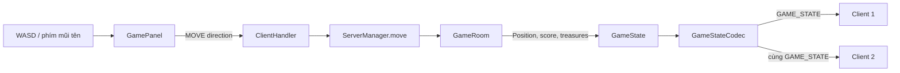

# 01. Tổng quan và luồng gameplay end-to-end

## 1. Trách nhiệm của Sơn trong kiến trúc chung

Phần Sơn bắt đầu khi hai người đã được đưa vào một Room và kết thúc ở việc hai Client hiển thị cùng trạng thái gameplay.

Điểm quan trọng nhất:

> Client gửi ý định. Server quyết định kết quả.

Client không được gửi:

- tọa độ muốn tới;
- số điểm muốn cộng;
- danh sách rương mới;
- một `GAME_STATE` tự tạo.

## 2. Vai trò từng lớp

### `GamePanel`

- Gắn WASD, phím mũi tên và nút điều hướng.
- Gửi chuỗi hướng qua callback.
- Nhận `GameState` đã decode để cập nhật HUD và Board.
- Hiện thông báo nhặt rương.

### `ClientHandler`

- Nhận dòng `MOVE|UP` từ Socket.
- Phân loại message.
- Chuyển handler hiện tại và direction sang `ServerManager.move()`.

Handler hiện tại quan trọng vì Server xác định người gửi theo phiên kết nối, không tin username do Client tự khai báo.

### `ServerManager.move()`

- Kiểm tra đã login.
- Kiểm tra Player đang `PLAYING`.
- Tìm Room chứa đúng Player.
- Khóa Room.
- Gọi xử lý di chuyển và nhặt rương.
- Gửi event và snapshot cho hai Client.

### `GameRoom`

- Giữ `GameState` có thẩm quyền.
- Kiểm tra bước đi.
- Cập nhật `Position`.
- Tìm rương tại vị trí mới.
- Cộng điểm và sinh rương mới.

### `GameStateCodec`

- Server chuyển object `GameState` thành chuỗi.
- Client chuyển chuỗi trở lại object.
- Kiểm tra map, điểm, vị trí và rương trước khi render.

### `BoardPanel`

- Chỉ vẽ snapshot.
- Không tự di chuyển nhân vật.
- Không tự xóa hoặc sinh rương.

## 3. Luồng một bước đi không có rương

Giả sử Alex đang ở `(3,3)` và bấm phím `W`.

1. `GamePanel` ánh xạ `W` thành direction `UP`.
2. MainFrame gửi `MOVE|UP`.
3. `ClientHandler` nhận message và gọi `serverManager.move(this, "UP")`.
4. Server lấy Player Alex từ handler.
5. Server tìm Room có object Player Alex.
6. Dưới khóa Room, `handleMove()` tính ô đích `(2,3)`.
7. Server kiểm tra `(2,3)` nằm trong map, không phải tường và không có đối thủ.
8. Server đặt Position của Alex thành `(2,3)`.
9. `collectTreasure()` không tìm thấy rương tại `(2,3)` nên trả `null`.
10. Server encode state mới và gửi `GAME_STATE` tới cả Alex và Nina.
11. Hai Client decode cùng payload rồi cùng vẽ Alex tại `(2,3)`.

## 4. Luồng một bước đi có rương

Giả sử ô `(2,3)` có rương bạc.

Các bước 1–8 giống phía trên, sau đó:

9. `collectTreasure()` tìm thấy rương `SILVER`.
10. Server tính giá trị bằng `Treasure.valueForType(SILVER) = 20`.
11. Server tạo rương thay thế tại một ô hợp lệ.
12. Server xóa rương cũ, thêm rương mới.
13. Server cộng `matchScore += 20` và `collectedTreasure += 1`.
14. Server gửi `TREASURE_COLLECTED` cho hai Client.
15. Server gửi `GAME_STATE` mới cho hai Client.

Thứ tự này có ý nghĩa:

- Event tạo thông báo “Alex nhặt rương bạc +20”.
- Snapshot sau event mới cập nhật HUD điểm và vị trí rương.

## 5. Luồng bước đi không hợp lệ

Nếu ô đích ngoài biên, là vật cản hoặc có đối thủ:

1. `handleMove()` trả chuỗi lỗi.
2. `ServerManager.move()` gửi `ERROR` cho người thực hiện.
3. Position, điểm và rương không thay đổi.
4. Không broadcast một state giả mới.

## 6. Ranh giới với phần thành viên khác

### Điểm bắt đầu từ phần Toàn

Toàn xử lý lời mời và tạo Room. Trong `createGameRoom()`, lời gọi `room.startGame()` là điểm bàn giao sang phần Sơn: sinh map và gameplay state.

### Điểm giao tiếp với phần Vinh

Vinh phụ trách Socket và `ClientHandler`. Sơn cần biết nhánh `MOVE` chuyển request sang `ServerManager.move()` nhưng không cần nhận phần quản lý kết nối.

### Điểm bàn giao sang phần Tùng

Sơn cập nhật `matchScore` khi nhặt rương. Khi hết giờ/thoát/mất kết nối, Tùng dùng các điểm đó để tạo kết quả, rank và history.

## 7. Ba thông điệp phải nói nhất quán

1. **Server authoritative:** Server mới có quyền thay đổi gameplay state.
2. **Snapshot synchronization:** hai Client nhận cùng state đã encode.
3. **Atomic room update:** MOVE, nhặt rương, respawn và broadcast được xử lý dưới cùng khóa Room.

